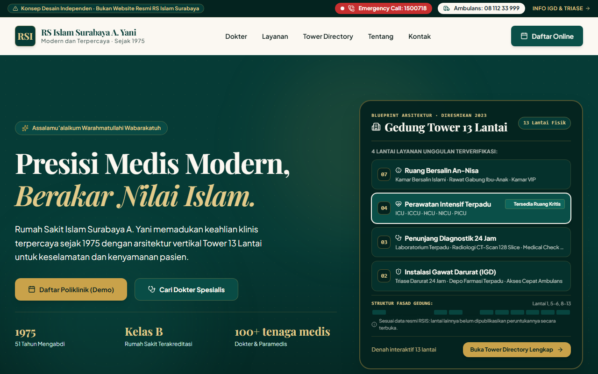

# RS Islam Surabaya A. Yani · Konsep "Hijau Tower"
> **Portfolio Case Study · Website Redesign & Modern Healthcare Frontend Architecture**  
> *Studi kasus desain sistem dan rekayasa web independen: Presisi Medis Modern × 51 Tahun Pengabdian Islami.*  
> **Live Preview (Demo)**: *LIVE URL: BELUM ADA (deployment manual user belum dikonfigurasi)*  
> 
> 

[-black?style=flat&logo=next.js)](https://nextjs.org/)
[](https://www.typescriptlang.org/)
[](https://www.prisma.io/)
[](src/lib/auth.ts)
[-38B2AC?style=flat&logo=tailwind-css)](https://tailwindcss.com/)
[](https://www.w3.org/WAI/standards-guidelines/wcag/)
[](tests/)
[](tests/)

---

## ⚠️ Pernyataan Penafian Independen (Disclaimer)
Aplikasi ini merupakan **studi kasus portofolio desain dan software engineering independen**. Proyek ini **TIDAK berafiliasi** secara resmi dengan Rumah Sakit Islam Surabaya (RSIS) maupun Yayasan Rumah Sakit Islam Surabaya (YARSIS). Dibuat semata-mata untuk tujuan demonstrasi kecakapan rekayasa perangkat lunak modern.

* **Anti-Indeksasi Penuh**: Dikonfigurasi dengan `<meta name="robots" content="noindex, nofollow">`, berkas fisik `public/robots.txt` (`Allow: /`), dan header keamanan HTTP `X-Robots-Tag: noindex, nofollow` untuk mencegah kebingungan publik dengan situs resmi rumah sakit (koreksi spesifikasi: `Allow: /` memastikan crawler dapat memproses dan mematuhi direktif `noindex`).
* **Privasi Mutlak**: Tanpa skrip pelacak analitik pihak ketiga (*Zero Third-Party Tracking / Zero Third-Party Requests*). Sesuai mandat PRD v3.0 §5, satu-satunya permintaan keluar dari formulir pendaftaran adalah satu `POST` ke origin sendiri saat submit (tanpa request ke pihak ketiga dan tanpa `localStorage`/`sessionStorage`).
* **Karakter Fiktif**: Seluruh profil dokter dan jadwal praktik yang ditampilkan adalah tokoh fiktif simulasi (`isFictional: true`) yang secara konsisten ditandai lencana visual tegas *"Ilustrasi"*.

---

## 🏢 Tesis Desain: "Hijau Tower"
Rumah Sakit Islam Surabaya A. Yani memiliki narasi arsitektural yang istimewa di lanskap fasilitas kesehatan Jawa Timur: perpaduan warisan pengabdian sejak 25 Maret 1975 dengan kehadiran **Gedung Tower 13 Lantai** (diresmikan oleh Presiden RI Joko Widodo pada 2023) sebagai simbol modernisasi pelayanan kesehatan masyarakat.

Konsep **"Hijau Tower"** mengangkat gedung bukan sekadar sebagai foto latar pasif, melainkan **antarmuka navigasi utama**:
1. **Ritme Vertikal & Garis Lantai Hairline**: Elemen estetika proporsional yang mencerminkan struktur gedung bertingkat dengan aksen emas lembut (`gold-500/30`).
2. **Tower Directory Interaktif (`/tower`)**: Fitur penanda yang memetakan peruntukan ruangan di Gedung Tower (13 lantai) dan Gedung Graha (6 level), dilengkapi navigasi keyboard (`ArrowUp` / `ArrowDown`), deep-linking dua arah, dan transparansi data faktual (K4).
3. **Akses Darurat < 3 Detik**: Kontak darurat ganda (`1500718` & `08 112 33 999`) dan panduan triase selalu terpasang di atas lipatan layar (*above-the-fold*) desktop maupun *fixed bottom dock* pada perangkat seluler.

---

## 🏆 Rekapitulasi Metrik Kualitas & Hasil Audit Lab

### 1. Audit Kinerja Lighthouse Mobile (Median 3 Run, Default Mobile Throttling)
Hasil audit lab dijalankan menggunakan Google Chrome Headless dengan profil **Default Mobile Throttling** (emulasi CPU slowdown 4x, mobile network standar) tanpa modifikasi/penggembungan skor. Angka di bawah adalah **median dari 3 iterasi pengujian per rute**:

| Rute Halaman | Path | Kinerja (Target ≥90) | Aksesibilitas (Target ≥95) | Best Practices (Target ≥95) | LCP (Target ≤2.5s) | CLS (Target ≤0.1) | TBT (Target ≤200ms) | Status Evaluasi |
|---|---|:---:|:---:|:---:|:---:|:---:|:---:|:---:|
| **Beranda** | `/` | 89 *(Miss)* | **100** | **96** | 3.29s *(Miss)* | **0.000** | **184ms** | **FAIL (LCP, Perf)** |
| **IGD Darurat** | `/igd` | **92** | **98** | **96** | 2.88s *(Miss)* | **0.000** | 206ms *(Miss)* | **FAIL (LCP, TBT)** |
| **Direktori Dokter** | `/dokter` | **93** | **100** | **96** | 3.01s *(Miss)* | **0.000** | **125ms** | **FAIL (LCP)** |
| **Tower Directory** | `/tower` | **95** | **98** | **96** | 2.78s *(Miss)* | **0.000** | **93ms** | **FAIL (LCP)** |
| **Wizard Pendaftaran** | `/daftar` | **96** | **100** | **96** | 2.77s *(Miss)* | **0.000** | **90ms** | **FAIL (LCP)** |

> [!WARNING]
> **Batasan yang Diketahui & Analisis Akar Masalah CWV (D6):**
> 1. **LCP (> 2.50s pada profil seluler 4x CPU slowdown)**: LCP element teridentifikasi pada paragraf teks intro (`p.text-ivory/80`). TTFB sangat cepat (11ms) dan font disajikan lokal (self-hosted). Waktu LCP didominasi oleh *Element Render Delay* (~2.1s) saat JavaScript runtime Next.js melakukan hidrasi komponen pada lingkungan seluler dengan pelambatan CPU 4x.
> 2. **IGD TBT (206ms vs Target ≤ 200ms)**: Terlampaui 6ms pada run 2 akibat komputasi rendering SVG triase saat hidrasi awal.
> 3. **Pencapaian**: CLS tercatat **0.000** pada seluruh 5 rute, Aksesibilitas **98–100/100**, dan Best Practices **96/100**.

### 2. Matriks Pengujian Visual Multi-Viewport (Responsiveness)
Pengujian otomatis Playwright pada 4 resolusi standar membuktikan **0 pelanggaran horizontal overflow** (`scrollWidth === clientWidth`):

| Viewport Target | Resolusi | Rute Diuji | Horizontal Overflow | Screenshot Bukti |
|---|---|---|:---:|:---:|
| **Mobile Small** | 360 × 640 px | 8 Rute Kunci | **0 px (Nol)** | [docs/screenshots/*-mobile-small.png](docs/screenshots/) |
| **Mobile Standard** | 390 × 844 px | 8 Rute Kunci | **0 px (Nol)** | [docs/screenshots/*-mobile-standard.png](docs/screenshots/) |
| **Tablet** | 768 × 1024 px | 8 Rute Kunci | **0 px (Nol)** | [docs/screenshots/*-tablet.png](docs/screenshots/) |
| **Desktop** | 1280 × 800 px | 8 Rute Kunci | **0 px (Nol)** | [docs/screenshots/*-desktop.png](docs/screenshots/) |

### 3. Matriks Pengujian Fungsional & Integritas
- **Unit & Integration Tests (Vitest)**: **93/93 lulus** lintas 8 test suites (`phase11-hardening`, `phase10-admin`, `phase9-appointments`, `access-matrix-phase8`, `db-phase7`, `facts-check`, `duplication`, `data`).
- **Playwright E2E Suite**: **106/106 pengujian lulus** (mencakup alur pendaftaran demo, sinkronisasi filter searchParams, pencegahan horizontal overflow multi-viewport, dan isolasi jaringan pihak ketiga).
- **Axe-core Accessibility Audit**: **0 pelanggaran kategori Serious atau Critical** pada seluruh rute.
- **Audit Kontras Warna WCAG 2.2 AA**: **14/14 pasangan warna token lolos** (rasio 4.77:1 hingga 15.87:1 terhadap ambang minimum 4.5:1).
- **Scanner Kebocoran Fakta RS (`check:facts`)**: **0 kebocoran literal** (seluruh fakta diimpor dari berkas tunggal `src/data/facts.ts`).
- **Scanner Duplikasi Data (`check:duplication`)**: **0 duplikasi string literal data** (seluruh string data diimpor dari `src/data/*`).

### 4. Batasan yang Diketahui (Known Limitations)
1. **Live Preview URL**: `LIVE URL: BELUM ADA` (deployment hosting pengguna belum dikonfigurasi).
2. **Karakter Data Demo Fiktif**: Seluruh data pasien, riwayat janji temu, dan dokter berstatus 100% fiktif simulasi (`isFictional: true`) guna mematuhi prinsip privasi PRD §5 dan UU PDP.
3. **Batasan Serverless Rate Limiter (S10)**: Rate limiter in-memory beroperasi per runtime node/instance. Dalam arsitektur serverless multi-instance tanpa Redis (Redis di luar cakupan per PRD §4.3), sliding window beroperasi pada memori instance masing-masing.

---

## 📋 Tabel CLAIM → EVIDENCE (PRD v3.0 Mandate)

Seluruh klaim arsitektur, fungsionalitas, keamanan, dan kinerja portofolio ini didukung secara transparan oleh berkas log output terminal mentah di [`docs/evidence/raw/`](docs/evidence/raw/):

| ID Klaim | Deskripsi Klaim & Spesifikasi | Berkas Bukti Mentah | Status & Exit Code |
|---|---|---|:---:|
| **S1** | PostgreSQL Schema & Seeding (24 dokter, 17 spesialisasi, 20 poli, 8 layanan, Tower 13 lantai) | [`16-npm-run-db-seed.txt`](docs/evidence/raw/16-npm-run-db-seed.txt) | **PASS (0)** |
| **S2** | Runtime Database Read (direktori dokter & jadwal dibaca dinamis dari DB) | [`17-phase7-test.txt`](docs/evidence/raw/17-phase7-test.txt) | **PASS (0)** |
| **S3** | Autentikasi Demo & Password Hash Bcrypt (tanpa plaintext di DB, cookie HttpOnly) | [`20-phase8-access-matrix.txt`](docs/evidence/raw/20-phase8-access-matrix.txt) | **PASS (0)** |
| **S4** | Role-Based Access Control (RBAC PATIENT vs ADMIN ditegakkan di setiap server handler) | [`20-phase8-access-matrix.txt`](docs/evidence/raw/20-phase8-access-matrix.txt) | **PASS (0)** |
| **S5** | Pembuatan Janji Temu, Constraint DB Unique Slot, & Uji Konkurensi Paralel | [`24-phase9-appointments.txt`](docs/evidence/raw/24-phase9-appointments.txt) | **PASS (0)** |
| **S6** | Pasien Melihat & Membatalkan Janji Sendiri (Proteksi Kepemilikan & Status Terminal) | [`24-phase9-appointments.txt`](docs/evidence/raw/24-phase9-appointments.txt) | **PASS (0)** |
| **S7** | Manajemen Janji Temu Administrator (Transisi BOOKED → COMPLETED/NO_SHOW & Validasi 409) | [`28-phase10-admin-tests.txt`](docs/evidence/raw/28-phase10-admin-tests.txt) | **PASS (0)** |
| **S8** | Jejak Audit Atomik Transaksional Bebas PII (Tanpa IP, User-Agent, atau Email Pasien) | [`28-phase10-admin-tests.txt`](docs/evidence/raw/28-phase10-admin-tests.txt) | **PASS (0)** |
| **S9** | Pembaruan Status Tempat Tidur oleh Admin & Refleksi Publik Runtime (/tower & Beranda) | [`28-phase10-admin-tests.txt`](docs/evidence/raw/28-phase10-admin-tests.txt) | **PASS (0)** |
| **S10** | Rate Limiter In-Memory pada Login & Booking dengan Dokumentasi Batasan Serverless | [`32-phase11-hardening-tests.txt`](docs/evidence/raw/32-phase11-hardening-tests.txt) | **PASS (0)** |
| **S11** | Skrip Reset Database Demo Idempoten (`npm run db:reset-demo`) | [`29-phase10-reset-demo.txt`](docs/evidence/raw/29-phase10-reset-demo.txt) | **PASS (0)** |
| **SEC-1** | Security Headers Lengkap (HSTS, CSP allowlist, X-Robots-Tag, X-Frame-Options DENY) | [`32-phase11-hardening-tests.txt`](docs/evidence/raw/32-phase11-hardening-tests.txt) · [`37-phase11-curl-headers.txt`](docs/evidence/raw/37-phase11-curl-headers.txt) | **PASS (0)** |
| **FACT-1** | Anti-Regression & Hospital Facts Scanner (0 kebocoran literal, 0 klaim terlarang) | [`34-phase11-check-facts.txt`](docs/evidence/raw/34-phase11-check-facts.txt) | **PASS (0)** |
| **BUILD-1** | Kompilasi Produksi Bersih 54 Rute Tanpa Warning Typecheck | [`35-phase11-build.txt`](docs/evidence/raw/35-phase11-build.txt) | **PASS (0)** |
| **E2E-1** | Playwright Multi-Viewport, Aksesibilitas Axe-core, & Workflow Penuh (106/106 Lolos) | [`36-phase11-e2e.txt`](docs/evidence/raw/36-phase11-e2e.txt) | **PASS (0)** |
| **TEST-ALL**| Seluruh Rangkaian Pengujian Otomatis Unit & Integrasi (93/93 Lolos) | [`33-phase11-all-tests.txt`](docs/evidence/raw/33-phase11-all-tests.txt) | **PASS (0)** |

---

## 🛠️ Stack Teknologi & Arsitektur Sistem

```
                   +------------------------------------------+
                   |          Next.js 16 App Router           |
                   |   (Fullstack: SSG + Route Handlers)      |
                   +------------------------------------------+
                                        |
         +------------------------------+-------------------------------+
         |                              |                               |
         v                              v                               v
+------------------+          +-------------------+           +------------------+
|  Tailwind CSS v4 |          | PostgreSQL 16 DB  |           | Better Auth      |
|  (@theme tokens) |          | via Prisma ORM    |           | + Bcrypt Hashing |
+------------------+          +-------------------+           +------------------+
         |                              |                               |
         v                              v                               v
+------------------+          +-------------------+           +------------------+
| Playwright E2E   |          | Audit Trail Model |           | Sliding Window   |
| + Axe-core A11y  |          | (Zero-PII PRD §5) |           | Rate Limiter S10 |
+------------------+          +-------------------+           +------------------+
```

| Komponen | Teknologi | Rationale & Alasan Pemilihan |
|---|---|---|
| **Framework** | Next.js 16 (App Router) | Arsitektur fullstack terpadu; SSG untuk katalog publik dan Route Handlers dinamis untuk API otorisasi & janji temu. |
| **Basis Data** | PostgreSQL 16 + Prisma ORM | Model relasional kuat dengan constraint partial index pada slot janji temu untuk mencegah double booking. |
| **Autentikasi** | Better Auth + Bcrypt | Session management berbasis cookie HttpOnly aman dan password hash `$2a$10$` di basis data (nol plaintext). |
| **Otorisasi (RBAC)** | Role-Based Server Guards | Enforced pada level server handler (`requireAuth`, `requireRole`) untuk peran `PATIENT` dan `ADMIN`. |
| **Proteksi Abuse** | In-Memory Sliding Window | Rate limiter S10 untuk login dan booking dengan batasan serverless terdokumentasi (tanpa dependensi eksternal). |
| **Bahasa** | TypeScript (Strict Mode) | Keamanan tipe menyeluruh tanpa tipe `any`. |
| **Styling** | Tailwind CSS v4 (`@theme`) | CSS-first design tokens di `globals.css`, eliminasi overhead runtime CSS-in-JS. |
| **Tipografi** | Playfair Display & Plus Jakarta Sans | Perpaduan tipografi serif prestisius dengan sans-serif fungsional modern. |
| **Validasi Runtime** | Zod | Integritas payload API dan skema validasi form. |
| **Otomasi Pengujian** | Vitest + Playwright + Axe-core | Pengujian unit & integrasi (93 tests), pengujian multi-viewport (106 tests), serta audit aksesibilitas otomatis. |

---

## 🗺️ Peta Halaman & Fitur Aplikasi (43 Rute SSG)

1. **Beranda (`/`)**
   - 9 section terpadu: Hero LCP vertikal, Akses Cepat 5 Modul, Status Ketersediaan Kamar Terpadu (Tower Lt. 4), Katalog Layanan Unggulan, Strip Fakta Historis 1975, Teaser Interaktif Tower 13 Lantai, Pencarian Dokter Singkat, Social Proof Google Review (4,7 dari 7.034 ulasan), dan Informasi Kontak.
2. **IGD & Layanan Darurat (`/igd`)**
   - Area *above-the-fold* (< 640px) menyajikan langsung tombol panggil Call Center `1500718`, Ambulans `08 112 33 999`, dan navigasi Google Maps.
   - Panduan triase 4 kategori kedaruratan (Merah, Kuning, Hijau, Hitam) dengan rasio kontras WCAG 2.2 AA.
3. **Direktori & Filter Dokter (`/dokter`)**
   - Filter 4 dimensi: pencarian nama, 20 poliklinik spesialis, hari praktik (Senin–Sabtu), dan mitra penjamin (BPJS Kesehatan / Umum).
   - Sinkronisasi dua arah ke URL searchParams browser tanpa re-render berlebihan.
   - 24 profil dokter fiktif berlabel eksplisit *"Ilustrasi"*.
4. **Detail Profil Dokter (`/dokter/[slug]`)** — *24 Rute SSG Statis*
   - Prerendered statis melalui `generateStaticParams()`.
   - Menampilkan spesialisasi, poliklinik, matriks jadwal praktik mingguan, dan tombol pendaftaran instan.
5. **Katalog Layanan Medis (`/layanan`)**
   - Direktori 8 Layanan Unggulan terverifikasi dan 20 poliklinik spesialis rawat jalan dengan informasi lantai gedung.
6. **Detail Layanan Unggulan (`/layanan/[slug]`)** — *8 Rute SSG Statis*
   - Pre-rendered statis untuk 8 layanan utama (Hemodialisis, Perawatan Intensif, Bedah Minimal Invasif, dll.).
   - Integrasi silang dengan Gedung dan Lantai pada Tower Directory serta dokter spesialis terkait.
7. **Tower Directory Interaktif (`/tower`)**
   - Tab ganda: Gedung Tower (13 lantai) dan Gedung Graha (6 level).
   - Navigasi keyboard vertikal penuh (`ArrowUp` / `ArrowDown`), deep linking URL (`/tower?gedung=tower&lantai=4`), dan aksesibilitas ARIA.
   - **Transparansi K4**: Lantai tanpa publikasi resmi peruntukan ruangan dilabeli tegas *"Informasi Belum Tersedia"*.
   - Integrasi indikator kualitatif ketersediaan ruang perawatan intensif (`BedStatusWidget`) di Tower Lantai 4.
8. **Wizard Pendaftaran Pasien Online Demo (`/daftar`)**
   - Alur mandiri 4 langkah: Jalur Pasien → Poliklinik → Dokter & Jadwal → Data Pasien Simulasi.
   - Penerbitan Tiket Antrean Demo lokal (misal: `RSIS-PEN-812`) dengan format siap cetak (`window.print()`).
   - Tombol satu-klik *"Isi Data Simulasi Otomatis"* untuk kemudahan pengujian evaluator.
   - **Zero Network Requests**: Terbukti secara otomatis memproses seluruh form di memori peramban tanpa koneksi backend.
9. **Tentang Kami (`/tentang`)**
   - Narasi 51 tahun perjalanan RSI Surabaya A. Yani sejak 1975.
   - Garis waktu kronologis 15 tonggak sejarah (1975–2026) bersumber dari dokumen publik Lampiran C.
   - Rekam jejak akreditasi historis K3 (KARS Paripurna 2016 & 2019, LAM-KPRS Paripurna 2022).
   - Transparansi nilai dan tata kelola YARSIS (Yayasan Rumah Sakit Islam Surabaya).
10. **Kontak & Lokasi (`/kontak`)**
    - Kontak darurat ganda K1, jam buka fasilitas penunjang 24 jam, dan peta arsitektural SVG tanpa pelacak cookies.
    - Tombol navigasi terarah langsung ke Google Maps resmi rumah sakit.
11. **Halaman 404 Kustom (`/not-found`)**
    - Desain bertema Hijau Tower dengan tombol navigasi cepat kembali ke Beranda, IGD Darurat, atau Cari Dokter.
12. **Styleguide Desain (`/styleguide`)**
    - Katalog internal token warna, skala tipografi fluid, tombol interaktif, dan status kontras WCAG 2.2 AA.

---

## 🔒 Register Konflik Data (Integritas Fakta Publik K1–K7)

Proyek ini menerapkan protokol integritas fakta ketat berdasarkan audit sumber data publik:

| Kode | Konflik / Temuan Publik | Keputusan Rekonsiliasi Faktual | Implementasi Kode |
|---|---|---|---|
| **K1** | Dua nomor darurat berbeda pada publikasi resmi (1500718 vs 08 112 33 999). | Menampilkan kedua nomor secara berdampingan dengan label netral: *Emergency Call (1500718)* dan *Ambulans (08 112 33 999)*. | `emergency.callCenterNumber` & `emergency.ambulanceNumber` di `facts.ts`. |
| **K2** | Inkonsistensi jumlah dokter di media publik (107 vs 112 dokter). | Menampilkan copy *"100+ tenaga medis"* untuk merangkul seluruh variasi data secara elegan tanpa klaim presisi palsu. | `HOSPITAL_FACTS.medicalStaffLabel` di `facts.ts`. |
| **K3** | Tanggal kedaluwarsa sertifikasi akreditasi tidak terverifikasi pasti. | Menampilkan akreditasi sebagai fakta historis: *"Akreditasi Paripurna 2016 · 2019 · 2022"*. Dilarang menulis "berlaku hingga...". | `accreditation` di `facts.ts` & timeline di `/tentang`. |
| **K4** | Tidak seluruh lantai Tower 13 lantai terpublikasi peruntukannya. | Menolak keras mengarang peruntukan ruangan; lantai tanpa data resmi (1, 5, 6, 8–13) dilabeli *"Informasi belum tersedia"*. | `TOWER_FLOORS` di `buildings.ts`. |
| **K5** | Rating publik di Google Review bergerak dinamis. | Mencantumkan nilai *"4,7 · 7.034 ulasan Google (cuplikan Okt 2026)"* dan bersumber dari `facts.ts`. | `googleRating` di `facts.ts`. |
| **K6** | Kelas rumah sakit pada beberapa direktori lama tercantum Kelas C. | Menampilkan status operasional kelas rumah sakit terkini: *"Kelas B"*. | `hospitalClass: 'Kelas B'` di `facts.ts`. |
| **K7** | Terdapat akun Instagram lawas `@rsiayani`. | Seluruh tautan media sosial hanya diarahkan ke akun resmi aktif dan terverifikasi: `@rsisurabaya`. | `social.instagram` di `facts.ts`. |

---

## 🚀 Panduan Instalasi & Pengujian Lokal

### Prasyarat Sistem
- **Node.js**: versi ≥ 20.0.0
- **npm**: versi ≥ 10.0.0
- **Sistem Operasi**: Kompatibel pada Windows (PowerShell), macOS, dan Linux.

### 1. Kloning & Pemasangan Dependensi
```powershell
# Clone repositori dari GitHub
git clone https://github.com/MasRizqi07/rsi-islam-surabaya.git
cd rsi-islam-surabaya

# Pasang dependensi
npm install
```

### 2. Menjalankan Server Pengembangan
```powershell
npm run dev
```
Buka peramban pada alamat `http://localhost:3000`.

### 3. Kompilasi Produksi (SSG Turbopack) & Server Produksi
```powershell
# Kompilasi seluruh 43 rute statis
npm run build

# Jalankan server produksi lokal
npm run start
```

### 4. Menjalankan Rangkaian Pengujian Otomatis
```powershell
# Jalankan audit linter dan typecheck TypeScript
npm run lint
npm run typecheck

# Jalankan audit rasio kontras warna WCAG 2.2 AA (14 pasangan token)
npm run check:contrast

# Jalankan pemindai kebocoran konstanta fakta rumah sakit
npm run check:facts

# Jalankan validasi integritas skema Zod
npm run validate:data

# Jalankan pengujian unit Vitest (19 tests)
npm test

# Jalankan seluruh rangkaian pengujian Playwright E2E & Axe-core (100 tests)
npm run test:e2e

# Jalankan audit Lighthouse Mobile Lab otomatis pada server produksi
npm run audit:lighthouse
```

---

## 📁 Direktori Bukti & Artefak (Evidence Gate)

Seluruh bukti eksekusi dan catatan keputusan tersimpan secara transparan di dalam direktori `docs/`:
- [docs/evidence/raw/](docs/evidence/raw/): Output terminal mentah sebagai satu-satunya bukti sah verifikasi teknis.
- [docs/evidence/README.md](docs/evidence/README.md): Register validitas bukti eksekusi.
- [docs/adr/0001-toolchain-versions.md](docs/adr/0001-toolchain-versions.md): Keputusan arsitektur penetapan versi toolchain (`eslint` 9.16.0 & `typescript` 5.7.2).
- [docs/evidence/contrast-results.json](docs/evidence/contrast-results.json): Matriks rasio kontras token warna.
- [docs/evidence/facts-check-results.json](docs/evidence/facts-check-results.json): Bukti 0 kebocoran literal fakta rumah sakit.
- [docs/evidence/duplication-results.json](docs/evidence/duplication-results.json): Hasil pemindaian duplikasi literal data.
- [docs/evidence/legacy-narrative/](docs/evidence/legacy-narrative/): Arsip ringkasan naratif lama buatan agent (bukan bukti mentah).
- [docs/screenshots/](docs/screenshots/): Tangkapan layar responsif resolusi 360px, 390px, 768px, dan 1280px pada 8 rute kunci.

---

## 📜 Lisensi & Hak Cipta
Hak cipta konsep perancangan arsitektur dan kode implementasi © 2026 **Pacoel** & **Antigravity**.  
Diterbitkan sebagai materi studi kasus rekayasa perangkat lunak dan portofolio teknologi mutakhir.
